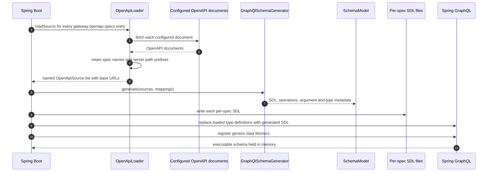
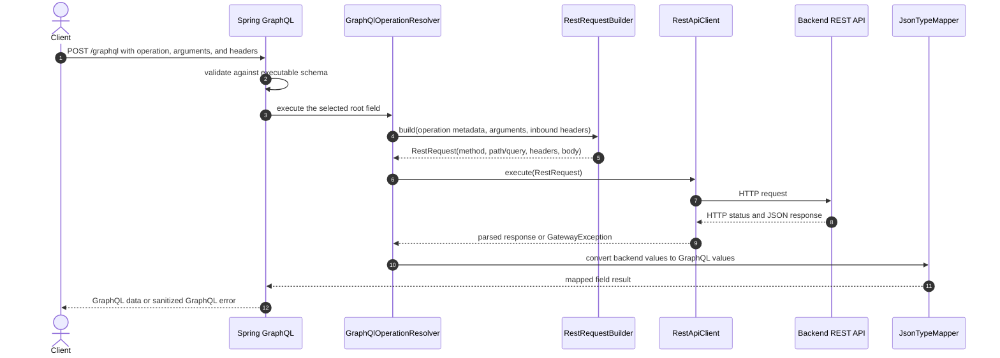
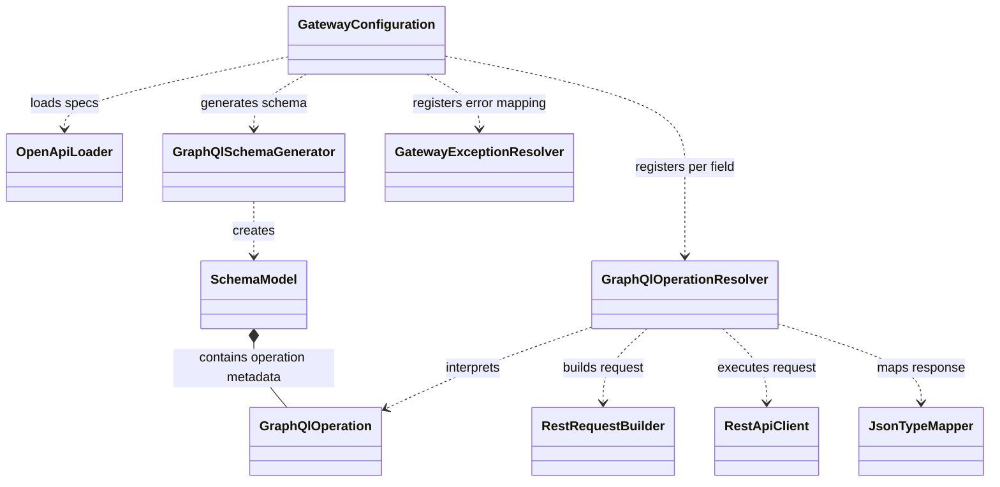

# GraphQL OpenAPI REST Gateway

This Spring Boot application exposes configured REST APIs through one GraphQL endpoint. It loads OpenAPI documents during startup, generates a GraphQL schema and operation metadata, then uses a generic resolver to translate each GraphQL field call into an HTTP request to the backend.

The gateway's admin, auth, billing, customer, network, report, and rule OpenAPI documents are configured individually in `src/main/resources/application.yml`.

## Runtime architecture

### Startup: load OpenAPI and build the schema

When `gateway.graphql.generate-schema` is enabled, this application fetches each document in `gateway.openapi.specs` and generates a named schema model. It writes one SDL file per spec for inspection. Spring GraphQL uses the merged definitions in memory for the single `/graphql` endpoint; the merged SDL is not written to disk.



Each spec requires its own `schema-output` path. Paths are relative to the application working directory unless absolute. In IntelliJ, use the repository root as the working directory to find them there.

The SDL is generated at startup, not read from disk for every request. The packaged JAR builds its active merged schema in memory from the OpenAPI documents fetched at that startup. Per-spec output files are human-readable artifacts for inspection; writing them while a JAR is running does not modify the JAR itself.

### Request: execute a GraphQL field against REST

Each generated root field is wired to a generic `GraphQlOperationResolver`. Its `GraphQlOperation` metadata identifies the HTTP method, path, parameters, body format, and response type. The request builder substitutes path variables, encodes query parameters, creates the body, and forwards configured inbound headers. The REST client performs the call, and the JSON type mapper shapes the returned data for GraphQL.



The core class relationships are:



## Understanding a GraphQL request

A GraphQL document can have an optional **operation name** and a schema-defined **field**:

```graphql
query CustomerGetCustomerListRequest {
  customerGetCustomerList {
    resultCode
    resultName
    resultType
    resultMessage
  }
}
```

Here, `CustomerGetCustomerListRequest` is a label chosen by the client. It is useful in logs and when a document contains multiple operations, but it is not defined by OpenAPI and does not select the backend route. The field `customerGetCustomerList` is defined by the generated schema and selects the resolver and REST operation. For a single-operation request, the operation name may be omitted:

```graphql
query {
  customerGetCustomerList {
    resultCode
    resultName
  }
}
```

You can inspect the generated schema descriptions in `schema.graphqls`. A root field description identifies the REST method and URL template and explains how each GraphQL argument maps to a REST path, query parameter, header, or request body. Startup logs print the same mapping. Path placeholders such as `{id}` are replaced with the corresponding GraphQL argument at runtime.

## OpenAPI-to-GraphQL mapping

The generator currently supports `GET`, `POST`, `PUT`, `PATCH`, and `DELETE`.

| OpenAPI operation | Generated GraphQL form |
| --- | --- |
| `GET` | A field under `Query` |
| `POST`, `PUT`, `PATCH`, `DELETE` | A field under `Mutation` |
| `operationId` | Base for the GraphQL field name; service namespaces are added when combining documents |
| Path parameter | GraphQL argument substituted into the URL path |
| Query parameter | GraphQL argument encoded into the query string |
| Header parameter | GraphQL argument sent as a backend header |
| JSON request body | Typed input argument when the OpenAPI schema can be represented; otherwise a JSON input |
| Multipart request body | JSON input describing form fields; file entries use `fileName`, `contentType`, and `contentBase64` |
| JSON response schema | GraphQL scalar, enum, object, or list type where supported |

The OpenAPI document's first `servers[].url` path is retained as the service prefix. Each spec's `base-url` supplies the backend origin for its GraphQL fields and REST calls. The generated SDL includes the combined route so you can see the effective mapping.

Manual mappings can rename an operation or override its method/path:

```yaml
gateway:
  mappings:
    - graphql: lookupCustomer
      operationId: customerGetCustomerList
```

A mapping with an `operationId` uses that operation's arguments and response metadata. A mapping without a matching operation ID must specify both `method` and `path`.

## Configuration

The main settings are in `src/main/resources/application.yml`:

```yaml
gateway:
  openapi:
    base-url: https://backend.example.com
    specs:
      - name: admin
        location: ${gateway.openapi.base-url}/api/admin/v3/api-docs
        base-url: ${gateway.openapi.base-url}
        schema-output: ${user.dir}/graphqls/admin.graphqls
      - name: auth
        location: ${gateway.openapi.base-url}/api/auth/v3/api-docs
        base-url: ${gateway.openapi.base-url}
        schema-output: ${user.dir}/graphqls/auth.graphqls
      - name: billing
        location: ${gateway.openapi.base-url}/api/billing/v3/api-docs
        base-url: ${gateway.openapi.base-url}
        schema-output: ${user.dir}/graphqls/billing.graphqls
      - name: customer
        location: ${gateway.openapi.base-url}/api/customer/v3/api-docs
        base-url: ${gateway.openapi.base-url}
        schema-output: ${user.dir}/graphqls/customer.graphqls
      - name: network
        location: ${gateway.openapi.base-url}/api/network/v3/api-docs
        base-url: ${gateway.openapi.base-url}
        schema-output: ${user.dir}/graphqls/network.graphqls
      - name: report
        location: ${gateway.openapi.base-url}/api/report/v3/api-docs
        base-url: ${gateway.openapi.base-url}
        schema-output: ${user.dir}/graphqls/report.graphqls
      - name: rule
        location: ${gateway.openapi.base-url}/api/rule/v3/api-docs
        base-url: ${gateway.openapi.base-url}
        schema-output: ${user.dir}/graphqls/rule.graphqls
  graphql:
    generate-schema: true
  headers:
    forward:
      - Authorization
      - X-Correlation-Id
      - Cmp-Session-Id
  mappings: []
  rest:
    connect-timeout: 2s
    read-timeout: 10s
```

Every `gateway.openapi.specs` entry requires a unique `name`, a direct OpenAPI document `location`, an absolute backend `base-url`, and a `schema-output` path. The name prefixes that spec's GraphQL fields and types. Supported document locations are `http(s):`, `file:`, and `classpath:`. The gateway rejects duplicate per-spec output paths and serves all configured specs from one `/graphql` endpoint using a merged schema held in memory. To route requests for a spec to another backend, change only that entry's `base-url`.

Spring's relaxed environment-variable binding supports settings such as:

- `GATEWAY_GRAPHQL_GENERATE_SCHEMA`

When `generate-schema` is enabled (the default), the application needs access to every configured OpenAPI location at startup and write access to each schema output path. If generation is disabled, OpenAPI operations and their generic REST resolvers are not created; a static schema and its runtime wiring must be supplied separately.

## Run locally

The Maven project targets Java 25. From the repository root, run:

```bash
./mvnw spring-boot:run
```

Or run `com.github.senocak.gateway.GatewayApplication` from IntelliJ IDEA, with the repository root as the working directory. Startup fetches the configured API documents, writes the SDL, and logs each generated GraphQL-to-REST mapping. GraphiQL is enabled at [http://localhost:8080/graphiql](http://localhost:8080/graphiql), and the GraphQL HTTP endpoint is `POST http://localhost:8080/graphql`.

A minimal HTTP request looks like:

```http
POST http://localhost:8080/graphql
Content-Type: application/json
Authorization: Bearer {{token}}

{
  "query": "query { authGetUserInfo { resultCode name surname email } }"
}
```

Use the `.http` files in `src/main/resources` for additional backend and gateway request examples. Replace token/session placeholders with valid values. The gateway forwards `Authorization` and the configured headers; it does not create or validate your backend token.

## Logging and errors

Startup logs include lines similar to:

```text
GraphQL mapping: QUERY authGetUserInfo -> GET https://.../api/auth/v1/users/profile; arguments: [...]
```

The REST client logs backend method, target, and response status. Request/response details and bodies are logged at DEBUG for `com.github.senocak.gateway.client.RestApiClient`, which is enabled in the default application configuration. Use debug body logging only with test data because payloads can contain sensitive values.

Backend failures become GraphQL errors with a safe message, `status`, and `classification` extensions. Detailed causes stay in application logs. A backend business response such as `resultCode` and `resultMessage` remains ordinary GraphQL data when the backend returns it in a successful HTTP response.

## Build and tests

```bash
./mvnw test
./mvnw package
```

Tests use JUnit 5, Spring Boot Test, Spring GraphQL Test, Mockito, and WireMock. The integration tests exercise GraphQL-to-REST mapping against a local mock backend. Some existing tests expect `src/main/resources/openapi.json`; that fixture is not present in this checkout, so restore/provide it before expecting the entire test suite to pass.

The project `pom.xml` targets Java 25, while the current Dockerfile uses a Java 21 build image. Align the Docker build image with the Maven Java target before using `docker compose up --build`.

## Project layout

```text
src/main/java/com/github/senocak/gateway/
├── config/       Startup wiring, properties, and configuration errors
├── openapi/      Swagger/OpenAPI loading and source metadata
├── graphql/      Schema generation, SDL rendering, and request context
├── model/        Operation, argument, response, and schema metadata
├── resolver/     Generic GraphQL resolver and GraphQL error mapping
├── mapping/      REST request construction and JSON type conversion
├── client/       Backend HTTP client and request/error models
└── security/     Inbound authentication propagation
src/main/resources/
├── application.yml
├── graphql/schema.graphqls
└── *.http        API request examples
src/test/java/com/github/senocak/gateway/
    Matching unit and integration test packages
```

Do not commit access tokens, customer data, or other secrets in configuration or `.http` files.
